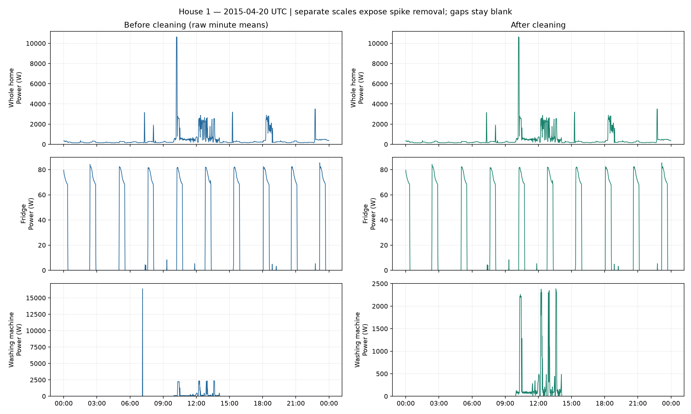
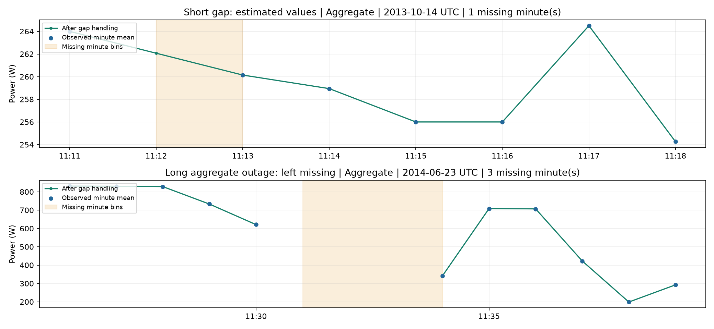

# Data and preprocessing

## Dataset overview

[REFIT Electrical Load Measurements](https://pureportal.strath.ac.uk/en/datasets/refit-electrical-load-measurements/), University of Strathclyde, supplies the raw and official cleaned releases. Section 1 uses `RAW_House1_Part1.csv` and `RAW_House1_Part2.csv`. House 1 covers **2013-10-09 14:06:17+00:00 to 2015-07-10 11:56:32+00:00**. Source sampling is nominally about 8 seconds and is irregular; the outputs use 1-minute arithmetic means. All power values are in watts (W).

## Raw inspection: House 1

| Finding | Value |
| --- | ---: |
| Raw rows (both parts, before deduplication) | 8,518,763 |
| Coverage start (UTC) | 2013-10-09 14:06:17+00:00 |
| Coverage end (UTC) | 2015-07-10 11:56:32+00:00 |
| Invalid Unix timestamps | 0 |
| Unparseable text timestamps | 0 |
| Text/Unix discrepancies | 4,152,843 |
| Backward time steps in source order | 2 |
| Duplicate timestamps removed | 1,211,048 |
| Unique timestamp rows | 7,307,715 |
| Median sampling interval (seconds) | 7.000 |
| Mean sampling interval (seconds) | 7.554 |
| 95th percentile interval (seconds) | 13.000 |
| Maximum timestamp gap (seconds) | 3,594,414 |
| Timestamp intervals > 60 seconds | 4,040 |
| Timestamp intervals > 120 seconds | 530 |
| Timestamp intervals > 300 seconds | 390 |
| Missing/non-finite power cells in raw input | 5,284,083 |
| Negative power cells in raw input | 0 |
| Appliance cells > 3,500 W in raw input | 3,954 |
| Aggregate cells > 25,000 W in raw input | 3 |
| Appliance cells > 3,500 W removed after deduplication | 3,128 |
| Aggregate cells > 25,000 W removed after deduplication | 3 |
| Individual appliance > Aggregate violations (cells) | 50,411 |
| Rows with any appliance > Aggregate | 50,228 |
| Sum of all appliances > Aggregate (complete rows only) | 62,380 |
| Complete rows eligible for sum comparison | 6,093,556 |
| Calendar minute bins | 920,031 |
| Missing channel-minute cells before interpolation | 1,268,779 |
| Short channel gaps interpolated | 8,024 |
| Channel-minute cells interpolated | 9,365 |
| Aggregate minutes interpolated | 588 |
| Unbounded short gaps left missing | 0 |
| Aggregate outage runs > 2 missing minutes | 448 |
| Aggregate long-outage minutes left missing | 114,543 |
| All missing channel-minute cells after cleaning | 1,259,414 |
| Maximum raw washing-machine power (W) | 73,725.000 |
| Maximum cleaned washing-machine minute mean (W) | 2,464.818 |

Raw-input cell counts include duplicated rows. Removal counts are measured after timestamp deduplication, so the two counts need not match. A channel-minute cell is one channel in one minute; it is not a whole-house minute. Text timestamp minus Unix offsets: 0 seconds: 4,365,920 rows, 1 seconds: 4,152,843 rows. Timestamp gaps describe absent source rows; channel gaps also include missing or rejected sensor values. Detailed machine-readable records are in [audit.json](reports/raw_house1/audit.json), [aggregate gaps](reports/raw_house1/aggregate_gaps.csv) and [all channel gaps](reports/raw_house1/channel_gaps.csv).

## Cleaning steps and reasons

1. **Use Unix time, sort and deduplicate.** Convert Unix timestamps to UTC, sort stably, and retain the last source row at each duplicate timestamp (`keep='last'`). Unix gives an unambiguous timeline; the text column is audited separately rather than silently mixing its one-second discrepancies or local-time assumptions into the index. This rule is reproducible but does not reconstruct the official REFIT corrections.
2. **Remove invalid and extreme readings before averaging.** Non-finite and negative values become `NaN`. Appliance1–Appliance9 readings above **3,500 W** and Aggregate readings above **25,000 W** also become `NaN`. A UK 13 A plug at 230 V corresponds to about 3,000 W; 3,500 W allows a screening margin. [Electrical Safety First](https://www.electricalsafetyfirst.org.uk/safety-advice/home-and-people/house-maintenance/plugs-and-fuses/) describes the approximately 3,000 W socket rating. The aggregate cutoff allows a margin above 230 V × an assumed 100 A service (23,000 W). These are engineering screening assumptions for this exercise, not verified fuse ratings for House 1 or universal physical limits for every appliance. No statistical cutoff is fitted to hide high but plausible cycles.
3. **Average valid readings within each minute.** Missing bins remain missing; a boundary reading contributes only to its own bin. Nothing is carried forward across an outage. A partially observed minute can still have a mean: resampling alone does not establish full-minute coverage.
4. **Fill only short, bounded gaps.** Interpolate whole runs of at most two missing minute bins, using the values on either side. Leave runs of three or more missing minutes unchanged; interpolation can smooth a real switching event.
5. **Keep outages explicit.** Longer runs remain `NaN`. The exported minute table includes `is_long_outage`, defined as an Aggregate run longer than two missing minute bins. Channel-specific missing runs and reasons for filling or leaving them are exported separately. Sub-meter/aggregate mismatches are counted but are not automatically removed by this raw pipeline: asynchronous measurements can disagree, and the comparison cannot identify the faulty sensor on its own.

## Duplicate sensitivity and clock conventions

Of the 1,211,048 excess timestamp rows, 71.89% have identical powers and missingness to the first source row at that timestamp; 28.11% differ. Mean absolute difference between keep-last and per-timestamp means is 1.211 W across finite channel/timestamp pairs in duplicated groups. This comparison uses original power values before outlier masking; missing values compare equal for the identical/conflicting classification.

The raw House 1 start label 14:06:17 differs from the cleaned label 13:06:17 on 2013-10-09 by one hour, consistent with BST (UTC+1) and the documented daylight-saving correction. Raw inspection uses the supplied Unix-to-UTC timeline; the offset alone does not establish both source clocks were correctly calibrated. Section 1 washing-machine EDA hour/weekday tables retain the cleaned source timestamp convention; the House 3 model illustration explicitly converts UTC to Europe/London local time.

After minute averaging, linearly interpolate complete missing runs of one or two consecutive bins when readings exist on both sides. Runs of three or more minutes remain NaN and are flagged as outages; no part of a longer run is filled.

## Before and after cleaning

The plot channels are Aggregate, Appliance1 (Fridge, as named in the supplied REFIT readme), and Appliance5 (Washing Machine). The selected day is **2015-04-20 00:00:00+00:00**, chosen to contain a roughly 16 kW washing-machine minute spike and observed heating activity. Separate panels show its peak falling from **16,387.2 W** before cleaning to **2,385.8 W** after invalid readings are removed; the after panel uses its own readable scale. Values below the cutoff are retained, but this does not recover the true power during a rejected sensor glitch. The additional examples below show actual short-gap interpolation and an unfilled long outage on their own dates, rather than claiming both occurred on the spike day.

Blue dots are available minute means; green points/lines show the result after gap handling. Orange shading marks missing bins. The short supported gap receives an estimate; the long outage stays blank.

## Official cleaned data: Sections 2 and 3

EDA uses Houses 1, 2, 3, 7, 8 and 10 at one-minute resolution without added filling. Channels are Appliance5, Appliance2, Appliance6, Appliance5, Appliance4 and Appliance5 respectively. Training uses 1, 2, 7 and 10; validation uses 8; test uses 3.

The official release already forward-filled some readings and replaced appliance spikes above 4,000 W with zeros. Missing intervals, asynchronous polling and uncertain cycle boundaries remain limitations; EDA observation coverage is distinct from the model evaluation mask described in RESULTS.md.
