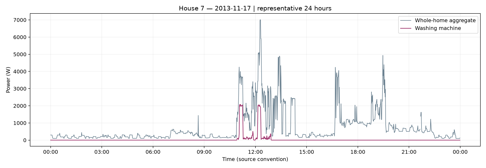
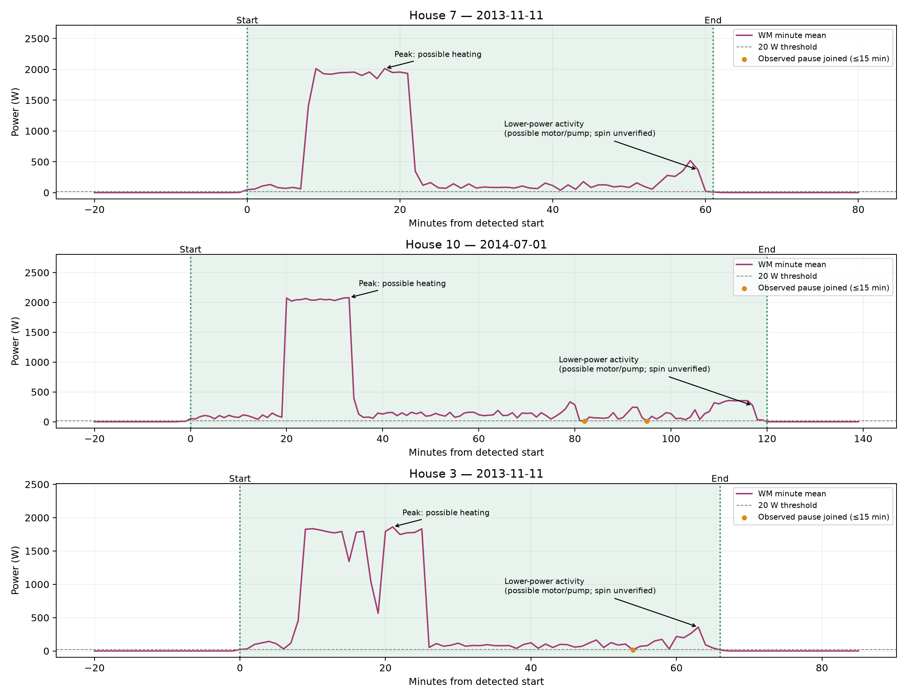
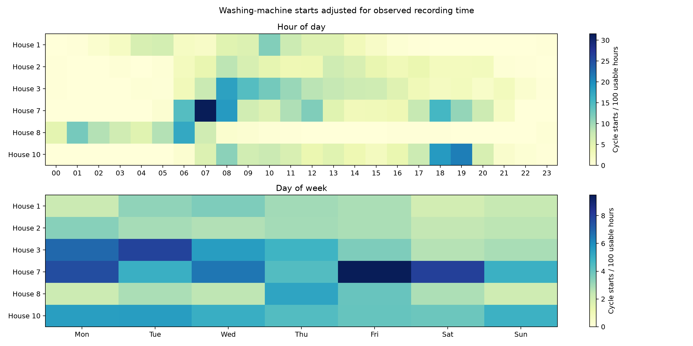
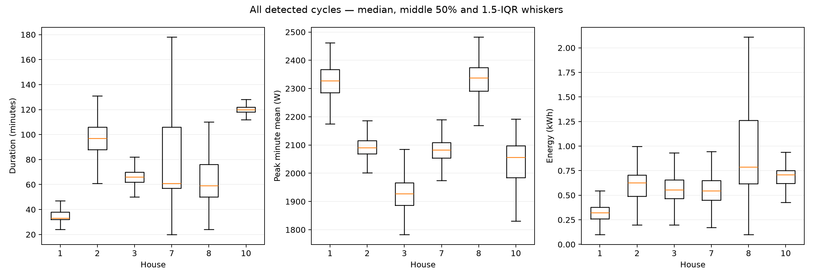
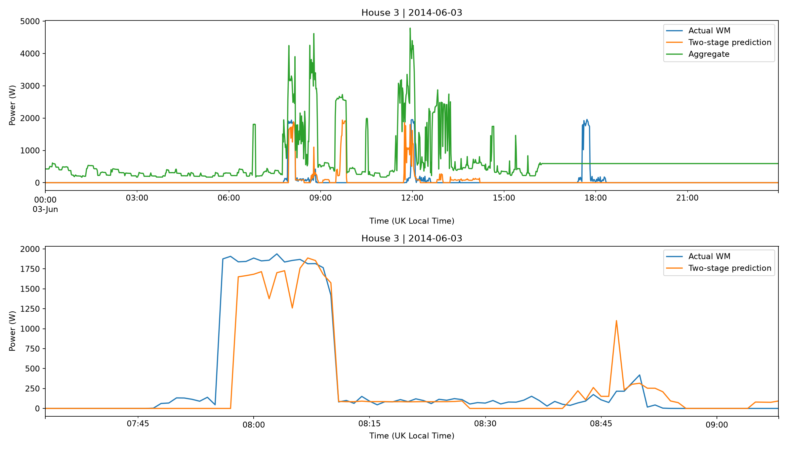
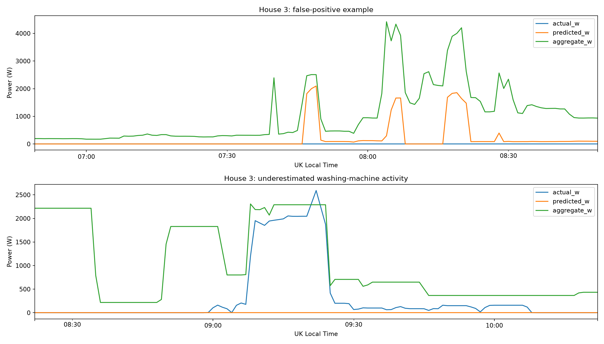

# Results

We estimate washing-machine power from one-minute whole-home readings using a simple activity classifier and an active-power regressor. On House 3, minute F1 is 42.84% and cycle F1 is 52.09%, with 9.0-minute median matched start error. Stage 2 active-minute MAE is 347.23 W versus 462.28 W for the plain classifier, while overall MAE is 48.49 versus 32.13 W. Both named splits and six-house LOHO show where results transfer and where they fail.

| Evaluation | Model | MAE W | Active MAE W | F1 % | Energy error % |
| --- | --- | --- | --- | --- | --- |
| House 3 test | always_off | 28.649 | 505.480 | 0.000 | 100.000 |
| 6-house mean | always_off | 26.226 | 527.546 | 0.000 | 100.000 |
| House 3 test | usage_profile | 48.610 | 470.021 | 16.705 | 15.863 |
| 6-house mean | usage_profile | 48.093 | 500.645 | 11.481 | 61.792 |
| House 3 test | two_stage_hgb | 48.487 | 347.226 | 42.836 | 53.030 |
| 6-house mean | two_stage_hgb | 46.667 | 356.673 | 36.995 | 78.569 |

Overlapping high-power appliances cause false positives; 94.34% of House 3 evaluated minutes are below the 20 W activity threshold. House 3 overall MAE is 48.49 W versus always-off 28.65 W; total-energy error is 53.03% versus hourly-profile 15.86%. The suitable use is evaluated cycle timing and opt-in feedback, not appliance billing.

## 1. Washing-machine EDA

Official cleaned REFIT data are averaged to one-minute bins for Houses 1, 2, 3, 7, 8 and 10. A usable minute has at least three valid paired readings spanning 30 seconds. Missing or insufficient observations stay separate from off time.

| House | WM channel | Start | End | Missing % | Off % | Cycles | Cycles / observed week |
| --- | --- | --- | --- | --- | --- | --- | --- |
| 1 | Appliance5 | 2013-10-09 13:06:17 | 2015-07-10 11:56:32 | 12.642 | 98.114 | 369 | 4.652 |
| 2 | Appliance2 | 2013-09-17 22:08:11 | 2015-05-28 08:05:43 | 24.623 | 95.284 | 314 | 4.762 |
| 3 | Appliance6 | 2013-09-25 19:21:09 | 2015-06-02 10:55:42 | 11.377 | 94.327 | 631 | 8.152 |
| 7 | Appliance5 | 2013-11-01 22:01:18 | 2015-07-08 02:10:54 | 12.576 | 91.586 | 834 | 10.975 |
| 8 | Appliance4 | 2013-11-01 22:13:18 | 2015-05-10 23:36:10 | 10.267 | 96.653 | 369 | 5.231 |
| 10 | Appliance5 | 2013-11-20 11:31:18 | 2015-06-30 11:07:07 | 11.2 | 91.202 | 584 | 7.952 |

Mark a minute active at >=20 W, join sufficiently observed inactive pauses of up to 15 minutes, and retain sessions lasting >=20 minutes AND using >=0.10 kWh. Missing minutes break sessions; all passing candidates enter the analysis. These thresholds can merge nearby washes or omit short/cold programmes. Cycles/week uses observed recording exposure.

| House | Duration (min) median | Duration (min) Q1 | Duration (min) Q3 | Peak (W) median | Peak (W) Q1 | Peak (W) Q3 | Energy (kWh) median | Energy (kWh) Q1 | Energy (kWh) Q3 |
| --- | --- | --- | --- | --- | --- | --- | --- | --- | --- |
| 1 | 33.0 | 32.0 | 38.0 | 2327.75 | 2285.333 | 2366.9 | 0.322 | 0.261 | 0.377 |
| 2 | 97.0 | 88.0 | 106.0 | 2090.533 | 2068.694 | 2115.833 | 0.626 | 0.491 | 0.705 |
| 3 | 66.0 | 62.0 | 70.0 | 1927.3 | 1886.75 | 1966.212 | 0.555 | 0.467 | 0.656 |
| 7 | 61.0 | 57.0 | 106.0 | 2082.478 | 2054.361 | 2108.396 | 0.546 | 0.45 | 0.649 |
| 8 | 59.0 | 50.0 | 76.0 | 2337.2 | 2291.444 | 2374.5 | 0.786 | 0.617 | 1.262 |
| 10 | 120.0 | 118.0 | 122.0 | 2056.0 | 1984.722 | 2097.5 | 0.71 | 0.62 | 0.75 |

Quartiles describe the middle 50% of sessions; power is a peak minute mean. Energy is the sum of minute watts divided by 60,000.

| house | hour | hour_starts_per_100_hours | weekday | weekday_starts_per_100_hours |
| --- | --- | --- | --- | --- |
| 1 | 10:00 | 11.627 | Wednesday | 3.59 |
| 2 | 08:00 | 8.453 | Monday | 3.426 |
| 3 | 08:00 | 17.967 | Tuesday | 7.852 |
| 7 | 07:00 | 31.539 | Friday | 9.484 |
| 8 | 06:00 | 17.236 | Thursday | 5.311 |
| 10 | 19:00 | 21.125 | Tuesday | 5.551 |

The representative House 7 day is nearest median observed activity among well-observed days. Washing-machine peaks sit within larger whole-home variations.

Median-like examples show detected boundaries and observed pauses. Heating and motor phases are plausible interpretations, not verified programme labels.

Cycle starts are divided by usable recording hours for each hour and weekday. The homes have different peak start times, so pooled habits should not be applied to every customer.

Duration, peak power and cycle energy vary across homes. Differences may reflect machines, programmes or detection errors and do not establish relative efficiency.

### Numerical comparison

House 10 has the longest median session at 120.0 minutes [Q1–Q3: 118–122], versus 33.0 minutes in House 1. The tight two-hour cluster is consistent with a repeated programme or stable machine behaviour, but programmes were not logged, so the cause cannot be confirmed. House 8 has the highest median cycle energy, 0.786 kWh.

The pooled daytime (06:00–21:59) start rate is 5.55, versus 1.42 overnight, per 100 observed hours. These hours use the cleaned source UTC clock; the model illustration converts UTC to UK local time.

## 2. Model and evaluation

For each household and uninterrupted aggregate segment, subtract a trailing 60-minute rolling minimum. Features are current aggregate/base/net power plus trailing 15-, 30- and 60-minute mean, maximum and standard deviation of net power: twelve inputs in total. No clock or appliance inputs enter the trees.

A balanced HistGradientBoostingClassifier estimates the probability of WM >=20 W. The plain-classifier baseline multiplies this probability by training median active power; the two-stage model replaces that constant with an absolute-error HistGradientBoostingRegressor trained on active minutes. Both apply the same probability threshold and retain runs of at least ten minutes, then output probability × watts, clipped to 0–3,000 W. This batch run rule confirms activity retrospectively; it is not immediate automatic control. Threshold is selected only on validation F1, with MAE breaking ties.

Compare the classifier baseline directly with the two-stage model to judge whether Stage 2 helps estimate heating versus lower-power activity. Always-off and a training-only hourly mean provide the other baselines. Evaluation excludes missing aggregate/WM means and WM outside 0–3,500 W; training additionally excludes WM > Aggregate +100 W. Missing aggregate intervals break feature history and missing evaluation intervals break predicted runs.

Split A trains on Houses 3, 7, 8 and 10, validates on House 1 and tests on House 2. Split B trains on Houses 1, 2, 7 and 10, validates on House 8 and tests on House 3. LOHO holds out each home once with the fixed validation rotation recorded below; training always uses the remaining four. This is a within-cohort robustness check, not proof of external generalisation or removal of every source of selection bias.

### Both named splits and baselines

| fold | split | house | validation_house | training_houses | predictor | MAE_W | RMSE_W | active_MAE_W | inactive_MAE_W | precision_pct | recall_pct | F1_pct | true_energy_kwh | predicted_energy_kwh | SAE_pct |
| --- | --- | --- | --- | --- | --- | --- | --- | --- | --- | --- | --- | --- | --- | --- | --- |
| 2 | validation | 1 | 1 | 3,7,8,10 | always_off | 10.887 | 137.989 | 576.790 | 0.033 | 0.000 | 0.000 | 0.000 | 145.839 | 0.000 | 100.000 |
| 2 | validation | 1 | 1 | 3,7,8,10 | usage_profile | 40.215 | 140.201 | 543.126 | 30.570 | 2.244 | 79.293 | 4.364 | 145.839 | 411.073 | 181.867 |
| 2 | validation | 1 | 1 | 3,7,8,10 | plain_classifier | 14.063 | 135.683 | 544.085 | 3.898 | 14.996 | 42.083 | 22.112 | 145.839 | 60.669 | 58.400 |
| 2 | validation | 1 | 1 | 3,7,8,10 | two_stage_hgb | 19.623 | 154.963 | 450.896 | 11.352 | 15.011 | 42.069 | 22.126 | 145.839 | 188.954 | 29.563 |
| 2 | test | 2 | 1 | 3,7,8,10 | always_off | 18.090 | 171.813 | 384.139 | 0.085 | 0.000 | 0.000 | 0.000 | 202.055 | 0.000 | 100.000 |
| 2 | test | 2 | 1 | 3,7,8,10 | usage_profile | 45.308 | 171.522 | 351.112 | 30.266 | 6.174 | 87.702 | 11.536 | 202.055 | 342.859 | 69.686 |
| 2 | test | 2 | 1 | 3,7,8,10 | plain_classifier | 22.870 | 167.794 | 362.001 | 6.188 | 20.586 | 36.156 | 26.235 | 202.055 | 83.281 | 58.783 |
| 2 | test | 2 | 1 | 3,7,8,10 | two_stage_hgb | 39.755 | 220.347 | 289.702 | 27.461 | 20.585 | 36.083 | 26.215 | 202.055 | 384.983 | 90.533 |
| 3 | validation | 8 | 8 | 1,2,7,10 | always_off | 29.318 | 243.516 | 875.928 | 0.217 | 0.000 | 0.000 | 0.000 | 350.453 | 0.000 | 100.000 |
| 3 | validation | 8 | 8 | 1,2,7,10 | usage_profile | 51.993 | 243.695 | 859.232 | 24.245 | 1.714 | 27.885 | 3.229 | 350.453 | 288.105 | 17.791 |
| 3 | validation | 8 | 8 | 1,2,7,10 | plain_classifier | 31.127 | 238.820 | 834.111 | 3.526 | 33.574 | 51.456 | 40.635 | 350.453 | 58.699 | 83.250 |
| 3 | validation | 8 | 8 | 1,2,7,10 | two_stage_hgb | 39.985 | 255.351 | 662.293 | 18.594 | 33.568 | 51.435 | 40.624 | 350.453 | 324.421 | 7.428 |
| 3 | test | 3 | 8 | 1,2,7,10 | always_off | 28.649 | 207.630 | 505.480 | 0.033 | 0.000 | 0.000 | 0.000 | 374.539 | 0.000 | 100.000 |
| 3 | test | 3 | 8 | 1,2,7,10 | usage_profile | 48.610 | 204.716 | 470.021 | 23.320 | 9.227 | 88.081 | 16.705 | 374.539 | 315.125 | 15.863 |
| 3 | test | 3 | 8 | 1,2,7,10 | plain_classifier | 32.129 | 201.526 | 462.281 | 6.315 | 34.353 | 56.892 | 42.838 | 374.539 | 119.563 | 68.077 |
| 3 | test | 3 | 8 | 1,2,7,10 | two_stage_hgb | 48.487 | 257.239 | 347.226 | 30.559 | 34.355 | 56.878 | 42.836 | 374.539 | 573.156 | 53.030 |

### Cycle-level results

| fold | split | house | predictor | matching | true_cycles | predicted_cycles | matched_cycles | cycle_precision_pct | cycle_recall_pct | cycle_F1_pct | median_start_error_min | median_duration_error_min | median_energy_error_kwh | median_energy_error_pct |
| --- | --- | --- | --- | --- | --- | --- | --- | --- | --- | --- | --- | --- | --- | --- |
| 2 | validation | 1 | plain_classifier | overlap_or_start_30min | 367 | 125 | 23 | 18.400 | 6.267 | 9.350 | 31.000 | 58.000 | 0.261 | 67.997 |
| 2 | validation | 1 | plain_classifier | strict_start_10min | 367 | 125 | 5 | 4.000 | 1.362 | 2.033 | 4.000 | 36.000 | 0.471 | 78.645 |
| 2 | validation | 1 | two_stage_hgb | overlap_or_start_30min | 367 | 461 | 123 | 26.681 | 33.515 | 29.710 | 3.000 | 15.000 | 0.188 | 48.203 |
| 2 | validation | 1 | two_stage_hgb | strict_start_10min | 367 | 461 | 80 | 17.354 | 21.798 | 19.324 | 1.000 | 8.500 | 0.161 | 45.538 |
| 2 | test | 2 | plain_classifier | overlap_or_start_30min | 313 | 228 | 78 | 34.211 | 24.920 | 28.835 | 12.500 | 30.000 | 0.494 | 75.227 |
| 2 | test | 2 | plain_classifier | strict_start_10min | 313 | 228 | 35 | 15.351 | 11.182 | 12.939 | 6.000 | 26.000 | 0.557 | 78.042 |
| 2 | test | 2 | two_stage_hgb | overlap_or_start_30min | 313 | 589 | 156 | 26.486 | 49.840 | 34.590 | 9.000 | 47.000 | 0.234 | 39.456 |
| 2 | test | 2 | two_stage_hgb | strict_start_10min | 313 | 589 | 84 | 14.261 | 26.837 | 18.625 | 6.000 | 41.500 | 0.222 | 35.597 |
| 3 | validation | 8 | plain_classifier | overlap_or_start_30min | 367 | 78 | 59 | 75.641 | 16.076 | 26.517 | 9.000 | 15.000 | 0.895 | 89.524 |
| 3 | validation | 8 | plain_classifier | strict_start_10min | 367 | 78 | 30 | 38.462 | 8.174 | 13.483 | 4.500 | 14.000 | 0.857 | 88.389 |
| 3 | validation | 8 | two_stage_hgb | overlap_or_start_30min | 367 | 507 | 231 | 45.562 | 62.943 | 52.860 | 10.000 | 16.000 | 0.481 | 51.006 |
| 3 | validation | 8 | two_stage_hgb | strict_start_10min | 367 | 507 | 120 | 23.669 | 32.698 | 27.460 | 4.000 | 11.500 | 0.338 | 40.851 |
| 3 | test | 3 | plain_classifier | overlap_or_start_30min | 633 | 413 | 237 | 57.385 | 37.441 | 45.315 | 9.000 | 12.000 | 0.447 | 77.743 |
| 3 | test | 3 | plain_classifier | strict_start_10min | 633 | 413 | 162 | 39.225 | 25.592 | 30.975 | 7.500 | 7.000 | 0.427 | 77.492 |
| 3 | test | 3 | two_stage_hgb | overlap_or_start_30min | 633 | 949 | 412 | 43.414 | 65.087 | 52.086 | 9.000 | 15.000 | 0.156 | 26.701 |
| 3 | test | 3 | two_stage_hgb | strict_start_10min | 633 | 949 | 267 | 28.135 | 42.180 | 33.755 | 8.000 | 10.000 | 0.113 | 21.038 |

Reference and predicted cycles use >=20 W, observed pauses <=15 minutes, duration >=20 minutes AND energy >=0.10 kWh. Standard matching accepts overlap or starts within 30 minutes; strict matching requires start error <=10 minutes. Greedy one-to-one matching uses smallest start error first; matched start/duration/energy errors must be read with precision and recall. These reference cycles are rule-defined operating sessions, not manually labelled programmes.

### Six-house LOHO

| house | validation_house | training_houses | MAE_W | active_MAE_W | F1_pct | cycle_F1_pct | median_start_error_min | SAE_pct |
| --- | --- | --- | --- | --- | --- | --- | --- | --- |
| 1 | 2 | 3,7,8,10 | 30.379 | 371.636 | 18.113 | 42.630 | 1.000 | 158.135 |
| 2 | 1 | 3,7,8,10 | 39.755 | 289.702 | 26.215 | 34.590 | 9.000 | 90.533 |
| 3 | 8 | 1,2,7,10 | 48.487 | 347.226 | 42.836 | 52.086 | 9.000 | 53.030 |
| 7 | 10 | 1,2,3,8 | 62.614 | 244.678 | 50.092 | 64.349 | 9.000 | 89.789 |
| 8 | 7 | 1,2,3,10 | 59.866 | 610.369 | 36.893 | 45.864 | 6.000 | 76.340 |
| 10 | 3 | 1,2,7,8 | 38.899 | 276.429 | 47.822 | 60.241 | 20.000 | 3.588 |

| predictor | metric | mean | SD | median | Q1 | Q3 |
| --- | --- | --- | --- | --- | --- | --- |
| always_off | MAE_W | 26.226 | 9.936 | 28.983 | 20.730 | 31.651 |
| always_off | RMSE_W | 204.017 | 42.429 | 211.604 | 180.767 | 236.531 |
| always_off | active_MAE_W | 527.546 | 187.160 | 478.942 | 401.206 | 558.963 |
| always_off | F1_pct | 0.000 | 0.000 | 0.000 | 0.000 | 0.000 |
| always_off | SAE_pct | 100.000 | 0.000 | 100.000 | 100.000 | 100.000 |
| always_off | cycle_F1_pct | — | — | — | — | — |
| always_off | median_start_error_min | — | — | — | — | — |
| plain_classifier | MAE_W | 31.030 | 8.619 | 32.505 | 25.185 | 34.001 |
| plain_classifier | RMSE_W | 197.905 | 40.288 | 205.162 | 176.227 | 229.862 |
| plain_classifier | active_MAE_W | 480.401 | 177.765 | 427.791 | 369.826 | 501.890 |
| plain_classifier | F1_pct | 36.799 | 12.991 | 39.874 | 28.904 | 46.576 |
| plain_classifier | SAE_pct | 55.188 | 25.056 | 63.190 | 54.905 | 67.957 |
| plain_classifier | cycle_F1_pct | — | — | — | — | — |
| plain_classifier | median_start_error_min | — | — | — | — | — |
| two_stage_hgb | MAE_W | 46.667 | 12.690 | 44.121 | 39.113 | 57.021 |
| two_stage_hgb | RMSE_W | 237.809 | 44.630 | 238.793 | 218.371 | 269.477 |
| two_stage_hgb | active_MAE_W | 356.673 | 132.772 | 318.464 | 279.748 | 365.533 |
| two_stage_hgb | F1_pct | 36.995 | 12.614 | 39.864 | 28.885 | 46.576 |
| two_stage_hgb | SAE_pct | 78.569 | 50.753 | 83.064 | 58.857 | 90.347 |
| two_stage_hgb | cycle_F1_pct | 49.960 | 11.171 | 48.975 | 43.439 | 58.202 |
| two_stage_hgb | median_start_error_min | 9.000 | 6.229 | 9.000 | 6.750 | 9.000 |
| usage_profile | MAE_W | 48.093 | 4.752 | 49.006 | 46.134 | 50.967 |
| usage_profile | RMSE_W | 203.105 | 41.128 | 209.182 | 179.821 | 236.416 |
| usage_profile | active_MAE_W | 500.645 | 193.788 | 448.020 | 369.839 | 524.850 |
| usage_profile | F1_pct | 11.481 | 7.222 | 14.120 | 6.157 | 16.800 |
| usage_profile | SAE_pct | 61.792 | 61.749 | 37.577 | 28.207 | 63.981 |
| usage_profile | cycle_F1_pct | — | — | — | — | — |
| usage_profile | median_start_error_min | — | — | — | — | — |

The summary reports unweighted household means, sample SD, medians and Q1–Q3. Results describe these six houses; the full per-fold baseline rows are in loho_evaluation_metrics.csv.

The illustration uses 2014-06-03 with 1,440 observed minutes, nearest the median daily cycle F1 among eligible complete active days. The selected cycle has complete observed context; this figure complements the full-test tables rather than showing the best day.

At 2014-04-03 06:49:00 UTC, Appliance9 (Kettle) is the largest measured non-WM load at 1862.4 W. The diagnostic example is the largest false error with a non-WM channel >=1,000 W and >=50% of aggregate, if available; otherwise it is the largest unattributed false error. This identifies a measured overlapping load; it does not establish exactly why the classifier fired.

| channel | appliance | mean_W_at_false_alarm |
| --- | --- | --- |
| Appliance9 | Kettle | 1862.400 |
| Appliance3 | Freezer | 88.700 |
| Appliance2 | Fridge-Freezer | 83.600 |
| Appliance1 | Toaster | 0.000 |
| Appliance4 | Tumble Dryer | 0.000 |
| Appliance5 | Dishwasher | 0.000 |
| Appliance6 | Washing Machine | 0.000 |
| Appliance7 | Television Site | 0.000 |
| Appliance8 | Microwave | 0.000 |

### Coverage and selected thresholds

| fold | split | house | first | last | minutes | active_minutes |
| --- | --- | --- | --- | --- | --- | --- |
| 1 | validation | 2 | 2013-09-17 22:08:00 | 2015-05-28 08:05:00 | 670164 | 31419 |
| 1 | test | 1 | 2013-10-09 13:06:00 | 2015-07-10 11:56:00 | 803773 | 15125 |
| 2 | validation | 1 | 2013-10-09 13:06:00 | 2015-07-10 11:56:00 | 803773 | 15125 |
| 2 | test | 2 | 2013-09-17 22:08:00 | 2015-05-28 08:05:00 | 670164 | 31419 |
| 3 | validation | 8 | 2013-11-01 22:13:00 | 2015-05-10 23:36:00 | 717221 | 23834 |
| 3 | test | 3 | 2013-09-25 19:21:00 | 2015-06-02 10:55:00 | 784402 | 44409 |
| 7 | validation | 10 | 2013-11-20 11:31:00 | 2015-06-30 11:07:00 | 750586 | 65561 |
| 7 | test | 7 | 2013-11-01 22:01:00 | 2015-07-08 02:10:00 | 771928 | 64644 |
| 8 | validation | 7 | 2013-11-01 22:01:00 | 2015-07-08 02:10:00 | 771928 | 64644 |
| 8 | test | 8 | 2013-11-01 22:13:00 | 2015-05-10 23:36:00 | 717221 | 23834 |
| 10 | validation | 3 | 2013-09-25 19:21:00 | 2015-06-02 10:55:00 | 784402 | 44409 |
| 10 | test | 10 | 2013-11-20 11:31:00 | 2015-06-30 11:07:00 | 750586 | 65561 |

| test_house | validation_house | training_houses | threshold | median_active_power_W |
| --- | --- | --- | --- | --- |
| 1 | 2 | 3,7,8,10 | 0.050 | 115.800 |
| 2 | 1 | 3,7,8,10 | 0.500 | 115.800 |
| 3 | 8 | 1,2,7,10 | 0.800 | 108.111 |
| 7 | 10 | 1,2,3,8 | 0.700 | 113.789 |
| 8 | 7 | 1,2,3,10 | 0.750 | 110.750 |
| 10 | 3 | 1,2,7,8 | 0.800 | 108.700 |
